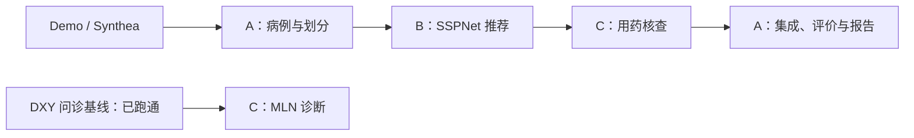

# 有医学知识依据的个性化用药推荐 agent

目标：SSPNet 产生个性化候选药物，借鉴 BIBM 的知识提取与规则化方法核查结果，由 agent 组织输入检查、工具调用和展示。

当前主线已可运行：结构化病例 → SSPNet真实推荐 → 有来源规则核查 → 返回候选、核查依据和补信息需求。下一步解决药物类别与具体成分之间的接口缺口，再做有明确评价对象的模块对照；零样本和DialMed延后。推荐与规则执行不依赖语言模型服务。

第一版使用已有诊断与结构化病历。DXY/Diaformer已完成150轮运行，原104条测试正确79条（75.96%）。SSPNet当前38类已完成20轮适配训练和重载，Jaccard74.65%、F1 80.91%，见[运行报告](src/recommendation/reports/sspnet-synthea-product-v4.md)。2026-11-14完成[DDI溯源、损失探针与简单基线](src/recommendation/reports/ddi-audit-20261114.md)；当前DDI率不能直接解释为临床风险。

本次集成对351条原测试输入全部计数：严格接口支持344条，其38类分数与原运行完全一致；7条含未支持编码，保留拒绝原因。默认自动规则包中2条通过agent来源/逻辑核对、1条拒绝；344条候选中127条缺少具体药物身份，217条未覆盖，**没有一条完成成分级核查**。另行跑通BIBM的受限条件MLN诊断：12条来源规则得到47/104（45.19%），低于已有Diaformer。68项测试通过；这是最小方法适配与接口集成，尚非原论文完整复现或有效性验证。见[集成报告](src/data_evaluation/reports/agent-integration-20261114.md)。

研究阶段先看[当前研究设计（含零样本对照）](docs/research-design.md)和[MIMIC-IV本人申请步骤](docs/mimic-access.md)。现有Synthea测试已用于错误分析，作为探索性结果；正式确认需未参与开发的真实数据。

已取得DDICorpus-2013、DDInter七分类和DialMed的dev/test，早期探索见[新数据与实验报告](src/knowledge/reports/open-data-pilot-20261114.md)。这些补充数据不替代纵向主队列。Qwen量化权重已完整校验并用CPU完成本次知识提取，服务随后关闭；未新增CUDA，零样本病例实验未启动。

**刚拉取仓库：先看 [三人开工步骤](docs/onboarding.md)，再进入自己的模块 README 和 TASKS。**最小调用入口见[运行步骤](src/data_evaluation/RUNNING.md)。病例、处理数据和模型权重不随Git克隆取得，需按模块说明重建或在许可范围内交接；不必重复训练已有可核对的本地产物。

## 目录框架

```text
src/
├── data_evaluation/     A：数据、评价、集成
│   ├── configs/         已有数据准备配置
│   ├── tests/           病例、划分和集成检查
│   └── reports/         数据及agent集成聚合报告
├── recommendation/     B：映射、药物图、SSPNet
│   ├── configs/         已有SSPNet运行配置
│   ├── tests/           已有映射、图、指标和模型检查
│   └── reports/         已有实际运行报告及聚合JSON
└── knowledge/          C：BIBM 诊断与用药核查
    ├── configs/         已有实验设置
    ├── prompts/         固定版本知识提取提示词
    ├── rules/           来源、模型原始规则与审核状态
    ├── tests/           条件、未知状态与MLN数学检查
    └── reports/         方法来源与实际运行报告
```

每个模块已有 README.md（从哪里开始）、TASKS.md（具体任务与验收）、AGENTS.md（修改范围）。已有代码的交付范围和未完成部分见各自README及TASKS。

以下两条最小工作链均已运行；用药核查覆盖与诊断效果的限制见集成报告：



两条链使用不同病例，不直接拼接。先验证各自模块，再评估推荐与知识核查的结合。

## 现在准备到哪里

| 内容 | 状态 |
|---|---|
| SSPNet / Diaformer 源码 | 已拉取并固定上游版本 |
| MIMIC-III Demo | 五张表可读取，覆盖 100 名患者；仅用于流程开发 |
| Synthea 合成病历 | 已下载官方历史 CSV 样本并检查：1,171 名合成患者，可用于推荐流程开发和模拟实验 |
| 药物映射、参考预处理与 DDI | 当前38类词表、EHR172边/DDI75边已生成；DDI来源逐项重建与梯度核验通过 |
| MIMIC-IV Demo / DDI外部核查清单 | 五表100人/275次原始住院尚待适配；250例清单已冻结50/5/195划分，位置与知识库基线已运行 |
| DDICorpus / DDInter / DialMed | 关系抽取数据已完整取得并训练轻量基线；DDInter七类检索已运行；DialMed dev/test已取得，推荐前输入待准备 |
| DXY / Muzhi | 已实际读取，样本数量、疾病和症状数与 BIBM 表 I 一致 |
| Synthetic 诊断集 | 文件可读取；采用现有 266 症状版本时记录与 BIBM 的差异，不等待同版本数据 |
| DXY / Diaformer 基线 | 环境、训练、问诊、保存与重载测试已通过；[结果与命令](docs/dxy-diaformer.md) |
| 后续条件 | 先用公开替代材料适配；BIBM 完整实现尚未找到，完整 MIMIC 权限未取得，不影响当前开发 |

详细数量、来源、检查范围和缺口见 [数据与代码状态](docs/resources.md)。

## 接下来做什么

A1 v3全量保留可关联就诊，主任务至少两次有效就诊、允许空操作。当前38类B数据为训练1433/验证354/测试351条；不再以旧24类筛选后的数量代表当前数据。先审核本次接口及运行证据，再由A/B共同核对现有RxNorm药品能支持怎样的更细输出，C明确每条规则需要的成分、途径和患者事实。更细输出需新版本训练与同条件比较，不能从当前答案补回具体药物。BIBM侧补知识获取与原方法缺口；现有低分结果保留，不能按同一测试成绩反复补规则。真实大规模验证数据尚未取得，申请可并行，不阻塞现有开发。

| 负责人 / 目录 | 第一阶段交付 | 完成依据 |
|---|---|---|
| [A：你，@lifan25](src/data_evaluation/README.md)；src/data_evaluation/ | 病例与患者划分、统一评价、最后的调用集成；审核并合并 B/C 的 PR | 无患者交叉/未来泄漏，指标可核对，最终调用可复查 |
| [成员 B：推荐](src/recommendation/README.md)；src/recommendation/ | 药物映射、词表与图、SSPNet 适配训练和 recommend 接口 | 编码/矩阵一致，实际前向与反向、重载推理通过 |
| [成员 C：知识](src/knowledge/README.md)；src/knowledge/ | BIBM 提示词/规则流程、MLN 诊断、带来源的用药核查接口 | 实际后端调用及核查分支可复查，缺失信息不会误报为安全 |

成员 B/C 暂不绑定账号，确定后由 A 填写各模块 TASKS.md。各自的代码、测试、配置和说明放进自己的目录，公共文件由 A 维护。

接手时先复核各自已交付产物：A看351条输入的分母与状态，B看权重/词表一致性和7条未支持输入，C看来源、拒绝规则及条件缺失。具体待办、产物和验收标准只维护在各模块TASKS.md。

成员从 b/、c/ 分支提 PR，只改自己的模块，由 @lifan25 审核并合并，不直接推送 main。公共接口见 [protocol.md](docs/protocol.md)，完整修改范围和操作步骤见 [CONTRIBUTING.md](CONTRIBUTING.md)。

2026-11-07 已核验：仓库公开，main 已启用经典分支保护。普通成员必须通过 PR，并获得至少一次批准及 Code Owner（@lifan25）的审核；新增提交撤销旧批准，合并前必须解决讨论，禁止强推和删除。非草稿 PR 应自动请求 @lifan25 审核，CODEOWNERS 检查无错误。

管理员保留绕过权限，供 A 处理自己的维护变更；不得用它替 B/C 跳过审核。批准后谁点击合并、每人修改哪些目录仍按协作规则执行，分支保护不是目录写权限。当前没有要求自动测试状态通过，后续建立实际检查后再配置。

## 同步和检查

首次取得项目：

```powershell
git clone --recurse-submodules https://github.com/lifan25/mmagent.git
Set-Location mmagent
```

已有本地项目，在项目根目录同步：

```powershell
git pull --ff-only
git submodule update --init --recursive
```

仅检查数据，无需安装 PyTorch：

```powershell
python scripts/fetch_public_demo.py --check-only
python scripts/check_diagnosis_data.py
```

使用自己已安装的 Python 解释器。脚本只报告聚合统计，不训练、不覆盖上游数据、不输出病例内容。

下载公开合成病历并查看本地病例预览：

```powershell
python scripts/fetch_synthea_sample.py
python scripts/preview_cases.py
```

预览位于 outputs/data-preview/病例预览.md，同目录有可读 JSON。这些是源数据示例，不是模型结果；保存在本地，不提交病例。Synthea 合成实验不能代表真实临床效果；换数据本身不作为研究贡献。

## 仓库入口

- [三人开工步骤与第一批 PR](docs/onboarding.md)。
- [数据、代码、环境与缺失材料](docs/resources.md)。
- [三人修改范围、PR 操作与组长验收](CONTRIBUTING.md)。
- [DXY / Diaformer 环境、运行与结果](docs/dxy-diaformer.md)。
- [上游代码及固定版本](third_party/README.md)。
- [公开 Demo 及许可证](data/public/mimiciii-demo-1.4/README.md)。
- [数据与接口协议](docs/protocol.md)；[虚构接口示例](examples/case.synthetic.json)。
- [实验记录模板](docs/templates/experiment.md)；[规则记录模板](docs/templates/rule.md)。

SSPNet 负责推荐，Diaformer 仅是 BIBM 的问诊依赖，不是 BIBM 完整实现。原始完整 MIMIC、受控病例、权重和密钥不上传；官方公开 Demo 保留其原始来源和许可证。

