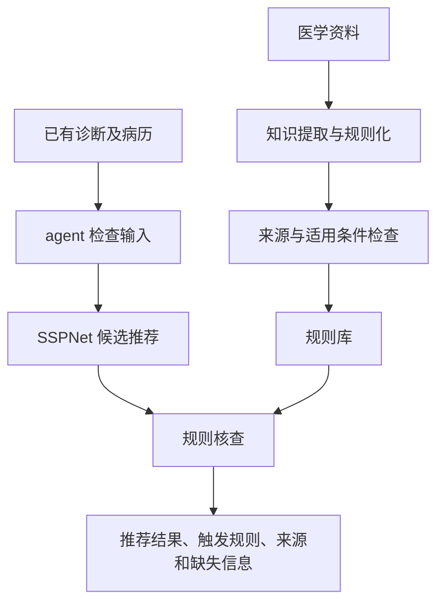

# 有医学知识依据的个性化用药推荐 agent

当前阶段：第一阶段——复现准备与协作约定。负责人 A / B / C 尚未指定姓名。

## 项目目标

分别复现 BIBM 2023 的知识提取、规则化与诊断流程，以及 IJCAI 2025 SSPNet 的药物推荐方法。在此基础上，将 BIBM 的知识处理方法扩展到用药知识，用规则核查 SSPNet 的候选结果，最后由 agent 组织信息检查、工具调用和结果展示。

第一版从已有诊断和结构化病历开始。症状问诊与诊断保留为独立复现任务；接入推荐流程需要另外解决编码、输入和共同评价数据问题。

## 系统流程



## 从哪里开始

1. 认领 [A：数据与评估](src/data_evaluation/TASKS.md)、[B：推荐](src/recommendation/TASKS.md)、[C：知识](src/knowledge/TASKS.md)，直接在各自 TASKS.md 更新任务和进度。
2. 在 [资源清单](docs/resources.md) 中补充证据和真实状态。
3. A 提出 [数据与接口协议](docs/protocol.md) 的修改，B、C 分别确认。
4. 按 [协作规则](CONTRIBUTING.md) 同步修改，不要求 Issue 或固定 PR 流程。
5. 按 [获取代码与同步说明](docs/github-setup.md) 拉取上游子模块。任务和完成条件的详细参考见 [phase1.md](docs/phase1.md)。

## 文档入口

| 文件 | 用途 | 主负责人 |
|---|---|---|
| [phase1.md](docs/phase1.md) | 任务、交付、依赖、完成判据 | A，三人共同确认 |
| [resources.md](docs/resources.md) | 论文、代码、数据、算力和费用的实际状态 | A 汇总，B/C 提供证据 |
| [protocol.md](docs/protocol.md) | 病例、推荐、规则、核查结果和实验协议 | A，B/C 评审 |
| [A TASKS.md](src/data_evaluation/TASKS.md) | 数据、评估与集成任务和结果 | A |
| [B TASKS.md](src/recommendation/TASKS.md) | SSPNet 任务和结果 | B |
| [C TASKS.md](src/knowledge/TASKS.md) | BIBM 与知识核查任务和结果 | C |
| [CONTRIBUTING.md](CONTRIBUTING.md) | 三人协作、分支、评审和完成规则 | 三人 |
| [AGENTS.md](AGENTS.md) | 使用 AI 编程助手时的工作边界 | 三人 |
| [实验模板](docs/templates/experiment.md) | 后续真实实验记录 | 实验执行人 |
| [规则模板](docs/templates/rule.md) | 知识来源、适用条件与审核记录 | C |

## 仓库现在有什么

仓库已关联 [SSPNet 与 Diaformer 原始代码](third_party/README.md)，并加入 [官方公开 MIMIC-III Demo](data/public/mimiciii-demo-1.4/README.md) 的五张表、许可证和下载检查脚本。没有训练结果，尚未实现两个方法的集成或 agent。

已经克隆的成员执行：

```powershell
git pull --ff-only
git submodule update --init --recursive
python scripts/fetch_public_demo.py --check-only
```

首次克隆使用 git clone --recurse-submodules https://github.com/lifan25/mmagent.git。Python 命令使用自己已安装的解释器。

Diaformer 上游已附带部分诊断数据、词表和预处理文件；其划分、完整性与 BIBM 复现设置仍需核对。BIBM 完整作者实现尚未取得。

`examples/` 中的全部病例和药物编码均为虚构值，不对应患者或真实药物。它们只用于讨论接口，不证明模型能运行。

## 阶段完成情况

| 阶段 | 当前状态 | 完成依据 |
|---|---|---|
| 第一阶段：复现准备 | 待三人执行与确认；已有文档骨架 | 见 phase1.md |
| 第二阶段：分别复现 | 未开始 | 两篇实际运行与评价结果 |
| 第三阶段：推荐与知识核查结合 | 未开始 | 同一病例经过推荐与核查的实际记录 |
| 第四阶段：对照实验与 agent 展示 | 未开始 | 核查前后对照、错误分析、可运行演示 |

## 数据和成果存放

代码、协议、虚构样例、允许分享的汇总结果进入 Git。官方公开 Demo 是本次明确加入的例外，保留原许可证及来源；完整 MIMIC、其他受控病例、模型权重、日志及密钥保存在授权环境，不进入 Git。文件被忽略不等于已经得到使用或分享许可。

